<h1 align="center">leap2-scanner</h1>

<p align="center">
  <b>Turn an Ultraleap Leap Motion Controller 2 into a handheld 3D scanner.</b><br>
  Plug it in, open the browser, sweep it over things, and get an STL mesh, a point cloud and a ready-to-train Gaussian-splat dataset.<br>
  No Ultraleap SDK, and no GPU needed for scanning.
</p>

<p align="center">
  <a href="#install">Install</a> ·
  <a href="#quick-start">Quick start</a> ·
  <a href="#cut-out-objects">Objects</a> ·
  <a href="#scanning-tips">Tips</a> ·
  <a href="#gaussian-splatting">Splatting</a> ·
  <a href="#how-it-works">How it works</a> ·
  <a href="#commands">Commands</a> ·
  <a href="#the-leap-2-as-a-stereo-camera">Under the hood</a>
</p>

<p align="center">
  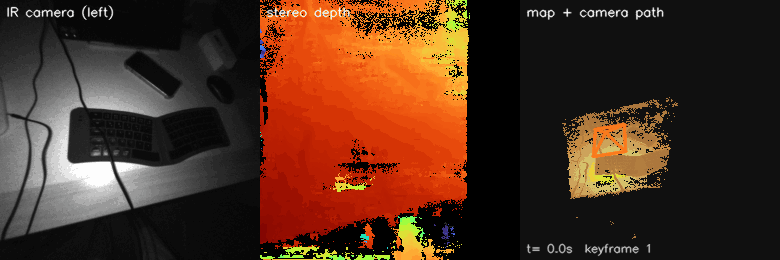<br>
  <sub>A 96-second handheld scan of a desk, every second keyframe. Left to right: IR camera, stereo depth, the map growing along the camera path.</sub>
</p>

<p align="center">
  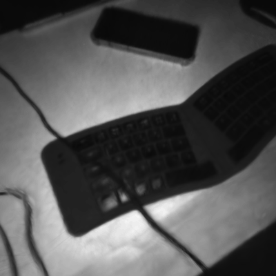
  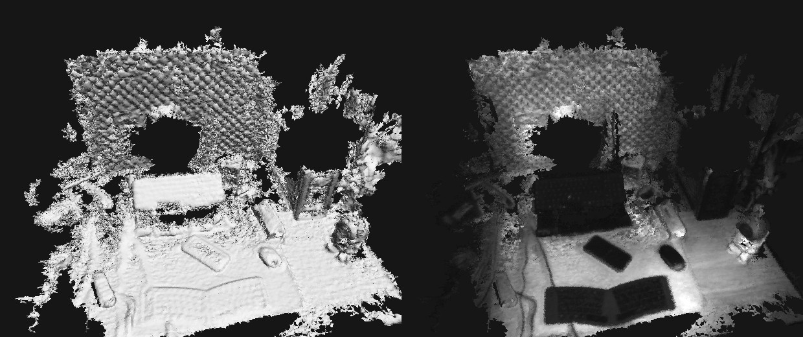<br>
  <sub>The same scan as a Gaussian splat (left) and as a 40 MB STL mesh, plain and with IR intensity (right).</sub>
</p>

## Features

- **Plain UVC access.** The Leap 2 is a normal V4L2 webcam; the stereo pair and its factory calibration are read straight from the device.
- **Live viewer in the browser** ([viser](https://viser.studio)): IR image, depth, the growing map, camera path, tracking and exposure hints.
- **Tracking:** KLT feature tracks against 3D map points, PnP RANSAC, ORB relocalization when lost.
- **Clean depth:** every frame (~20 fps) is fused into its keyframe, and a multi-view check removes stereo mismatches, so edges don't appear twice.
- **Loop closure on export:** all keyframe poses are optimized together on image features and the depth surfaces themselves.
- **Meshes on the CPU:** a sparse TSDF at ~1.5 mm, decimated to a fixed STL size (40 MB by default). Detail keeps its triangles, flat areas lose theirs.
- **Processing UI:** re-export with other settings, and cut single objects out as their own 1 mm meshes.
- **Gaussian splatting:** COLMAP and nerfstudio datasets, plus a gsplat trainer with depth supervision, pose refinement and exposure compensation, locally or on a remote GPU.

## Install

You need Linux (device access goes through V4L2 and UVC ioctls), Python ≥ 3.10 and a Leap Motion Controller 2, ideally on USB 3 (on USB 2 use `--res 512`).

```bash
git clone https://github.com/erelbng/leap2-scanner.git && cd leap2-scanner
python3 -m venv .venv && .venv/bin/pip install -e .     # or: uv venv && uv pip install -e .
./scan.sh                                               # same as: .venv/bin/leap2-scanner
```

<details><summary>Reuse system packages (small venv)</summary>

If your distro ships numpy, OpenCV, SciPy, scikit-image and trimesh (the optional hole filling then needs `opencv-contrib-python-headless` instead of the system OpenCV):

```bash
python3 -m venv --system-site-packages .venv
.venv/bin/pip install --no-deps viser msgspec websockets zstandard fast-simplification
```
</details>

## Quick start

```bash
./scan.sh            # opens the scanner at http://localhost:8080
```

1. Press **Start scan** (or launch with `--autostart`).
2. Move the Leap slowly, **15–60 cm** from things; that is what its IR LEDs light.
3. The camera in the 3D view turns **red** when tracking is lost: point back at an area you already scanned.
4. Press **Finish & export**. Everything goes to `scans/<date_time>/`; a 100-second scan takes about 8–10 minutes on a laptop CPU, half of it loop closure.

<p align="center">
  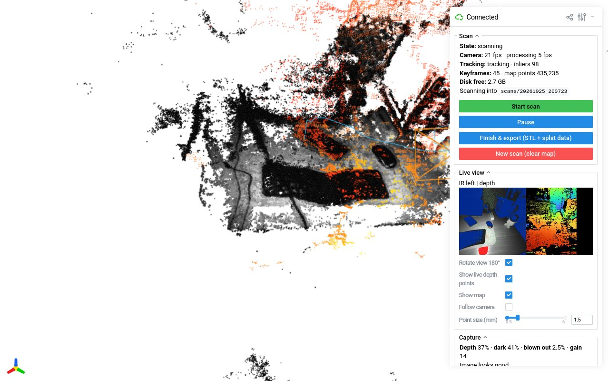
  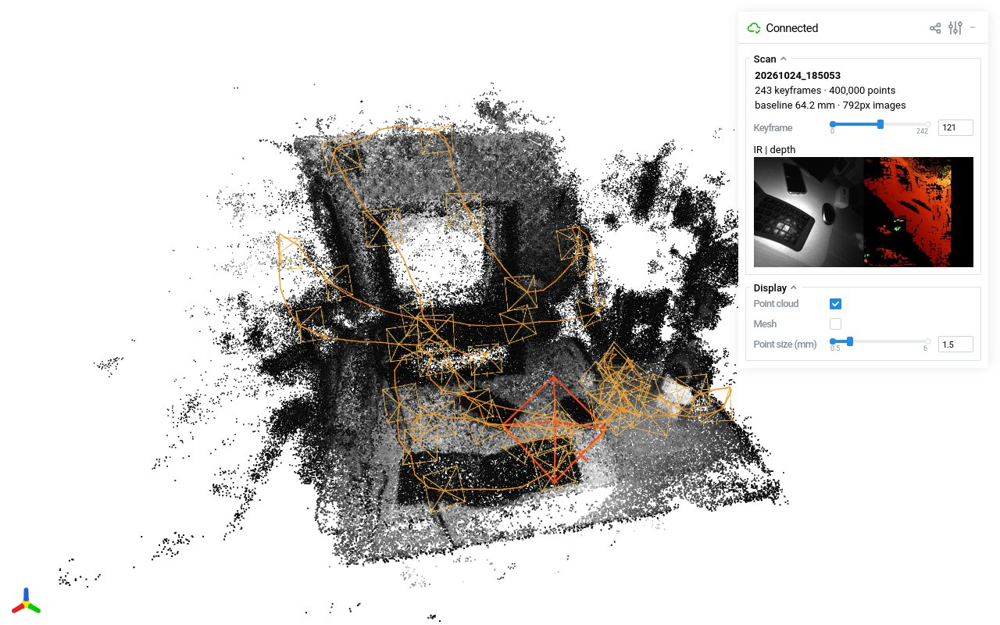<br>
  <sub>Left: the live scanner (here replaying a recorded scan) with exposure overlay, live depth and the growing map.
  Right: <code>./scan.sh view scans/&lt;name&gt;</code> shows the cloud, keyframe cameras and their IR and depth images.</sub>
</p>

## Cut out objects

```bash
./scan.sh process                  # newest scan, or: ./scan.sh process scans/<name>
```

A second browser UI (port 8090) for everything after scanning:

- **Export whole scan** with loop closure, mesh resolution, STL size and smoothing, with progress and a preview. *Mesh only* keeps the point cloud and splat data.
- **Object:** mesh just one object, at 1 mm.
  1. **Auto-fit box to object** boxes what the scan was centred on. If it rests on a surface (table, floor, shelf, wall, in any orientation), the box stands on it; otherwise the box follows the object's own shape.
     Move, turn or resize the box with the gizmo if needed; touching objects can't be separated by shape alone.
  2. **Mesh object.** *Box floor* sets what happens where the object rests: *keep everything*, *cut off* the surface, or *cut off + close* the object there with a flat face, ready for a slicer.
  3. The mesh is saved as `<name>.stl` / `.ply` in the scan folder (nothing is ever overwritten) and shown in the view.

<p align="center">
  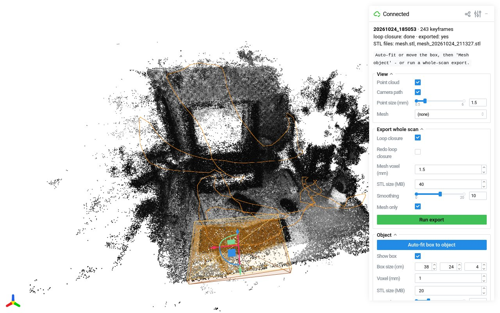<br>
  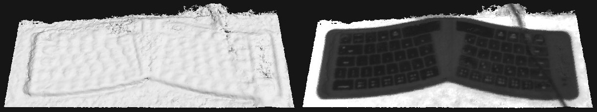<br>
  <sub>A foldable keyboard cut out of the desk scan above, at 1 mm (14 MB STL), with the desk around it kept. Plain and with IR intensity.</sub>
</p>

## Scanning tips

- **Use the Capture panel.** It marks blown-out (red) and too-dark (blue) pixels, shows depth coverage, and auto gain adjusts the sensor. **Detail mode** is for close passes over small things: denser keyframes, sharper stereo, and an extra 1 mm `mesh_detail.stl`.
- **Fill holes** (checkbox, or `--fill`) fills the pixels stereo can't match from a smoothed (WLS) match. In an A/B scan of the same desk that gave about 50% more mesh surface and fewer holes, but rougher surfaces, slightly lower accuracy and no better splats, so it's off by default.
- **Light is the biggest lever.** The IR LEDs reach about 60 cm. An incandescent or halogen lamp, daylight, or an 850 nm IR illuminator fills the dark parts; LED room lights emit almost no IR.
- **Go close and slow for detail.** Depth noise grows with distance squared: about 2 mm at 35 cm, 0.5 mm at 18 cm once fused. Oblique views give small things their shape.
- **Texture helps.** Plain, glossy or black things give little depth. A laptop screen is a dark mirror in IR: cover it with paper, or use an 850 nm IR dot projector, which turns the Leap into an active stereo camera.
- **Close the loop, but don't scrub.** End where you started; loop closure uses the overlap. One slow, steady sweep beats many passes over the same spot.
- **Scanning one object:** give it some space, circle it at 20–35 cm, then once more from another height, and keep it in the middle of the view. Then *Auto-fit* → *Mesh object*.
- The Leap sees **IR only**, so meshes and splats are greyscale.

## Gaussian splatting

Every exported scan is a 3DGS dataset: rectified images from both eyes, poses, a COLMAP model, `transforms.json` and an initial point cloud.
[`splat/train.py`](splat/train.py) trains it with [gsplat](https://github.com/nerfstudio-project/gsplat) and adds what suits this sensor:
depth supervision from the filtered stereo depth, one pose correction per keyframe, and per-image exposure compensation.

```bash
pip install -e ".[splat]"                      # NVIDIA GPU; install torch for your CUDA first
python splat/train.py --data scans/<name>
python splat/render.py --data scans/<name> --gif flythrough.gif
./scan.sh splat-view scans/<name>              # view in the browser, works on any machine
```

No GPU on the scanning laptop? Train on another machine over ssh/rsync (nothing is ever deleted on either side):

```bash
splat/remote_train.sh user@gpu-host            # copies the project + newest scan, trains in the background
splat/fetch.sh user@gpu-host <name>            # copies the result back (~130 MB)
```

`REMOTE_DIR` (default `leap2-scanner`), `REMOTE_PYTHON` and `REMOTE_ENV` (a conda env or venv prefix, put on `PATH` so gsplat finds `ninja` and `nvcc`) configure the remote side.

<p align="center">
  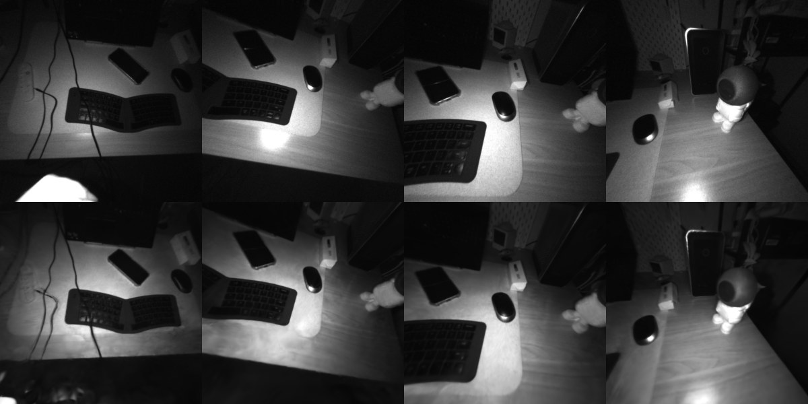<br>
  <sub>Views the training never saw: real IR images (top) and splat renders (bottom).
  243 keyframes, 15k iterations in 9.4 min on an RTX 4060, 23.3 dB PSNR on held-out views.</sub>
</p>

`point_cloud.ply` uses the standard 3DGS layout and opens in [SuperSplat](https://superspl.at/editor), [Brush](https://github.com/ArthurBrussee/brush) and other viewers. nerfstudio works too: `splat/train_splatfacto.sh scans/<name>`.

## How it works

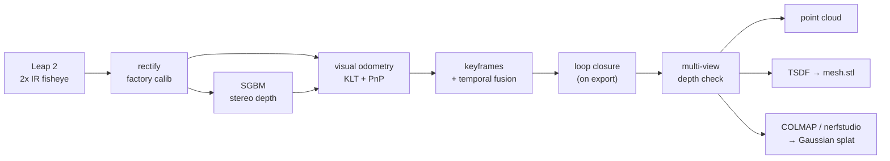

<p align="center">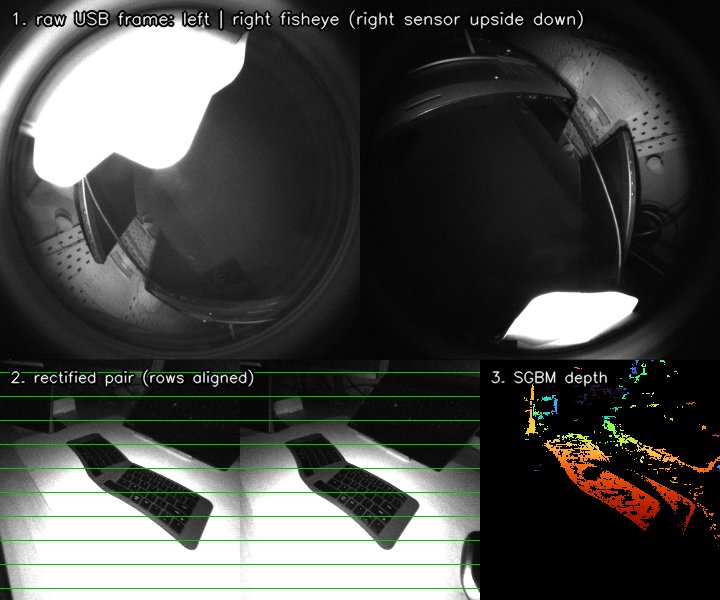</p>

1. Each USB frame holds both IR images side by side: ~160° fisheyes, the right sensor mounted upside down.
2. The factory calibration (refined, see below) rectifies them into a pinhole pair whose rows line up.
3. OpenCV SGBM matches on 2× downsampled images: in dark, noisy IR that gives about 5× more confirmed depth than full resolution, and it is 3× faster (`--stereo full` for the finer, sparser variant). Optionally, a WLS-filtered match fills the pixels it leaves empty.
4. Features on the left image are tracked against the map for the camera pose; a keyframe is kept every ~3 cm or 6°.
5. **Temporal fusion:** the 10–30 tracked frames between two keyframes are warped into it; pixels it measured are averaged with the frames that agree, pixels it missed are filled when three frames agree.
6. **Loop closure** (on export) corrects the keyframe poses.
7. **Multi-view check:** a depth pixel is used only if two of the six neighbouring keyframes see the same surface within 2%. What passes builds the point cloud, the TSDF mesh and the splat dataset.

<details><summary>Why edges used to appear two or three times</summary>
<p align="center">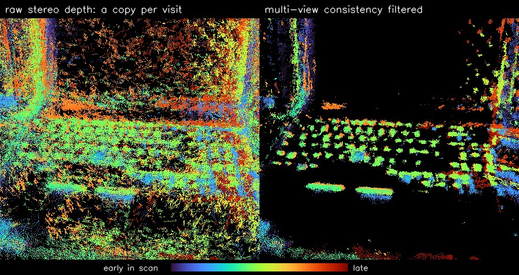</p>

Every keyframe's depth of a laptop, coloured by time: raw (left) leaves a copy of each edge per pass, filtered (right) is one clean grid.
The cause was wrong stereo matches, not tracking: 15–20% of SGBM pixels are off by more than 8% on repeating patterns, dark glossy surfaces and edges along the baseline.
They depend on the viewpoint, so neighbouring keyframes don't confirm them. The check keeps 55–60% of the depth; loosening it only lets in wrong pixels.
Longer scans also drift a few cm, which shows up as thick, blurred surfaces; loop closure removes most of that.
</details>

## Commands

| Command | What it does |
|---|---|
| `./scan.sh [--autostart] [--res 512] [--fill]` | Live scanner. `./scan.sh` and `leap2-scanner` are the same. |
| `./scan.sh view <scan>` | Browse a saved scan. |
| `./scan.sh process [scan]` | Export with settings, cut out objects (port 8090). |
| `./scan.sh export <scan>` | Redo the export (`--no-loop-closure`, `--redo-loop-closure`, `--mesh-only`). Earlier outputs move to `previous_export_<time>/`. |
| `./scan.sh export <scan> --mesh-only --stl-mb 80` | Mesh options: `--stl-mb` size budget (0 = no decimation), `--mesh-voxel-mm` (1.5), `--mesh-smooth` (10), `--detail-voxel-mm` (1). |
| `./scan.sh export <scan> --restereo half` | Recompute an older scan's depth with the current matcher. |
| `./scan.sh splat-view <scan>` | View a trained splat. |
| `./scan.sh check --save preview.png` | Check camera, calibration and depth. |
| `./scan.sh calibrate [--from-scan scans/<a> ...]` | Refine the stereo calibration, live or from saved scans. Once per device. |
| `splat/train.py`, `render.py`, `remote_train.sh`, `fetch.sh` | Splat training and rendering, see above. |

<details><summary>Output folder</summary>

```
scans/<date_time>/
├── images/kf_00012_L.jpg, _R.jpg     rectified IR images, both eyes
├── depth/, depth_filtered/           uint16 depth in mm: raw, and multi-view confirmed
├── keyframes.json                    intrinsics, baseline, camera->world poses (OpenCV axes)
├── keyframes_odometry.json           the live poses, before loop closure
├── calibration.json                  calibration used for this scan
├── pointcloud.ply                    fused point cloud (IR intensity as colour)
├── mesh.stl / mesh.ply               mesh (STL in mm, PLY in m with IR colour)
├── mesh_detail.stl, <name>.stl       detail-mode mesh, object meshes from `process`
├── sparse/0/, transforms.json        COLMAP model, nerfstudio dataset
├── splat/                            trained splat, renders, refined poses
└── previous_export_<time>/           earlier outputs, never overwritten
```
</details>

## The Leap 2 as a stereo camera

Notes from a Leap Motion Controller 2 (USB `2936:1206`, firmware 3.8.7) on Linux:

- **Video:** `/dev/videoN` offers "YUYV" at 512², 1024², 256², 512×256 and 144², but the bytes are two 8-bit IR images side by side (not interleaved as on the Leap 1). About 80 fps at 512², 50–85 fps at 1024². The last row carries metadata.
- **Factory calibration:** read-only `GET_CUR` on UVC extension unit **224, selector 25** returns 156 bytes: `"CA"`, version 3, then 17 floats per camera (fx, 0, 0, fy, cx, cy, five lens terms, Rodrigues rotation, translation) for the 512² stream. The lens terms are a radial polynomial in the incidence angle, r = θ + d0θ² + … + d4θ⁶. The baseline is **64.2 mm**, the right camera rotated by about 180°.
- **The factory extrinsics are about 0.2–0.3° off**, leaving rectified rows 1.6–2.5 px apart. `./scan.sh calibrate` refines the relative rotation from dense matches (live or from saved scans) down to 0.5 px, for about 20% more confirmed depth. The result is stored in `~/.config/leap2-scanner/` and used automatically.
- **Controls:** only *Gain* (0–15) has a visible effect; exposure is automatic and the IR LEDs light about 10–60 cm.

## Limitations

- Depth is sparse on textureless, saturated, black or glossy surfaces, so meshes have holes there.
- Long scans drift a little; loop closure fixes most of it, but far-apart passes agree less well than neighbouring keyframes.
- IR only, no colour.
- Tested on Debian 13 with firmware 3.8.7 and OpenCV 4.13 and 5.0. Other OSes would need their own way to read the UVC extension unit.

## Troubleshooting

| Problem | Fix |
|---|---|
| `No Ultraleap camera found` | Check `lsusb \| grep 2936`, replug or try another port. |
| Permission denied on `/dev/videoN` | `sudo usermod -aG video $USER`, then log in again. |
| Camera busy | Only one program can stream: stop the Ultraleap tracking service and other scanner instances. |
| Low fps or timeouts at 1024² | Use USB 3, or `--res 512`. |
| Everything dark | Get closer (IR LEDs reach ~60 cm), add daylight or an incandescent lamp. |
| Tracking keeps getting lost | Move slower, point at textured things, avoid blank walls and blown-out surfaces. |
| Viewer unreachable from another device | It binds to `127.0.0.1`; use `--host 0.0.0.0` on trusted networks only. |

<details><summary>Project layout</summary>

```
leap2_scanner/  device.py (UVC + calibration readout) · calib.py (fisheye models, rectification) · stereo.py (SGBM)
                tracking.py (visual odometry) · fusion.py (depth fusion and checks, TSDF, meshing)
                optimize.py (loop closure) · objects.py (object box fitting, cut + close) · export.py (storage, PLY/STL, COLMAP)
                app.py (scanner UI) · review.py · process.py · splatview.py (viewers) · tools.py (check, calibrate)
splat/          gsplat trainer, renderer, remote training, nerfstudio alternative
docs/           README media and the script that makes the scan animation
```
</details>

## Related projects

Two earlier projects scanned with the first-generation Leap Motion and its SDK, from single stereo frames:
[Palmr/LeapScan](https://github.com/Palmr/LeapScan), a weekend experiment with undistortion and OpenCV stereo, and
[3DLeapScanner/LeapScanner](https://github.com/3DLeapScanner/LeapScanner), a student project with checkerboard stereo calibration, SGBM with OpenCV's WLS disparity filter, and PCL meshes.
leap2-scanner targets the Leap 2 without the SDK and adds tracking, multi-frame fusion, loop closure and splats.
(Tested on Leap 2 data, the WLS filter trades accuracy for coverage rather than improving both, so here it is only an optional hole filler, `--fill`.)

## License

[MIT](LICENSE). leap2-scanner is not affiliated with or endorsed by Ultraleap; "Leap Motion" and "Ultraleap" are trademarks of Ultraleap Ltd.

<sub>This project was developed with the help of Claude Opus 5.5 (Anthropic) as an AI coding assistant.</sub>
